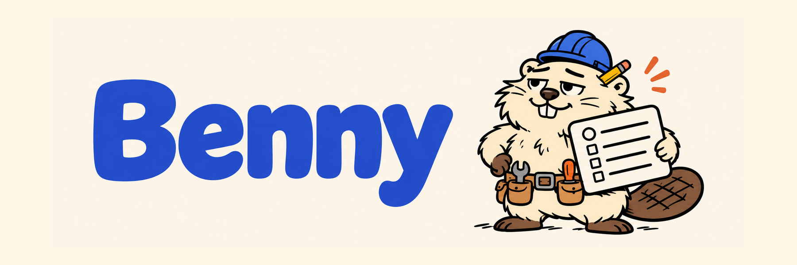
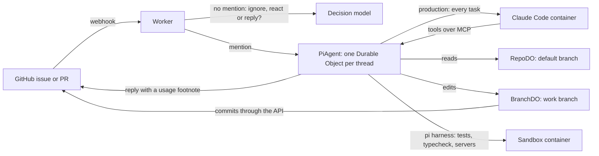

# Benny

**A persistent, self-hosted AI software engineer made for GitHub.** An open-source alternative to Devin, Capy and Factory's Droids. It works with the AI subscriptions you already pay for, like Claude Code and OpenCode Go.

Benny lives in my GitHub issues. I mention it, it researches, writes the requirements with me, works on its own branch and opens a PR. I run it myself: on my laptop, or on my own Cloudflare account so the laptop can be off.

> [!CAUTION]
> **This is an experiment.** Benny runs my own work on my own Cloudflare account. I share it as a reference for building an agent harness on Workers and Durable Objects. Read it, copy what you like, fork it.

<!-- Screenshot or GIF: a real issue thread, from the first mention to the opened PR. -->

## What a request looks like

The example is illustrative; the shape is real.

> **me:** @bobby-sb The dependency cache misses on every cold start, even when the lockfile is unchanged. Find out why and write the fix up as requirements on this issue.

Benny replies in the thread: what it read, what it found, what it proposes, and a question when it has one. We go back and forth until the requirements are right. Then:

> **me:** @bobby-sb start

It creates `bobby/issue-53`, commits there through the GitHub API and opens a PR that links the issue. Then:

> **me:** @bobby-sb Run the tests in the sandbox, then review the PR and fix what the review finds.

Every reply ends with a usage footnote, so I always know what a request took:

`Benny worked 4.2 min · 42 turns, 88k context (2.3M sent, 96% cached), 34k out · 12 tool calls`

## Why I built it

I wanted to learn harness engineering: build my own agent harness instead of living inside someone else's. [pi-durable](https://github.com/earendil-works/pi) gives me the agent loop. Cloudflare Workers run it, and Durable Objects hold the files and the running agents. I picked Cloudflare because it is extremely cheap, and because I think it's cool.

The first win came fast: a review agent on the spare OpenCode Go usage I was already paying for. Cheap models on a subscription, my own customisations, no lock-in to one vendor's agent.

The second win was putting everything in one place. GitHub is my Linear, my Notion and my code host. Benny creates and updates its own issues and tracks its progress there, in a UI I already live in.

Then I made Claude Code the harness in production, and kept pi for dev. Both sit behind one contract, so the rest of Benny does not know which one runs.

## Why GitHub

I started with GitHub because an engineering agent does not need another web app.

- **The primitives already exist.** Issues take the tasks, pull requests handle review, projects cover planning, wikis hold the docs, and labels track state.
- **Engineers already live there.** There is no new dashboard to check and no new tool to learn.
- **The context is already there.** The backlog, the discussions and the review history sit next to the code.
- **It costs nothing extra.** All of it comes with a GitHub account.

## Always on

Every issue gets its own agent, and that agent keeps its context and its work branch between messages. Once mentioned, Benny follows the thread and decides for itself whether a new comment needs a reply, a reaction or silence. It also runs recurring jobs on a schedule.

Always on does not mean always running. An agent sleeps between messages and costs nothing while it waits; a comment or a due schedule wakes it.

## A normal day

I mention `@bobby-sb` on a few issues and ask it to research things. The threads run at the same time. On the one I care about, we write the requirements together until I'm happy. I say start. It works on its own branch and opens a PR. I ask it to test its own work, get the PR reviewed, and fix what the review found.

Some work repeats, so a mention can also set a schedule: `@bobby-sb every weekday at 9am IST, post a digest of what merged and what is stuck`. Benny confirms the schedule and the next time in words, then posts in that issue each time it comes due. Closing the issue pauses it.

Benny puts `[INPUT_REQUIRED]` on the issue title and adds an `input-required` label when a reply ends on a question for me, when a run pauses at its time limit, or when a PR is ready for review. One search shows every thread that waits for me, and my next comment clears the mark.

It is the same loop I run with Claude Code on my laptop, with three differences: the laptop can be off, it runs on my own infrastructure, and I never think about which worktree or branch it is on. Nothing in it would break if three people used it.

## How it compares

Devin, Capy and Factory's Droids are the products people know in this space. Benny is one person's project, not a match for them feature by feature. What differs is where it lives and who runs it:

| | Where you talk to it | Who runs it |
| --- | --- | --- |
| **Benny** | GitHub issues and pull requests | You: your machine or your Cloudflare account. Open source. |
| Devin | Slack, PR comments, its own app | Cognition, hosted |
| Capy | Its own app, which opens PRs on GitHub | Capy, hosted |
| Factory's Droids | Terminal, IDE, browser, Slack | Factory, hosted |

## How it is built

- **One agent per thread.** Each issue or PR gets its own `PiAgent` Durable Object. It sleeps between messages and costs nothing while it waits. A person starts every run with a mention, or with a schedule that a mention set.
- **Files live in Durable Objects.** `RepoDO` holds the default branch, `BranchDO` the work branch. Commits go through the GitHub API: no clone, no git process.
- **Containers.** In production every request runs in the thread's Claude Code container, which holds a copy of the repo and runs the tests itself. In the pi harness, reading and editing code needs no container; for tests, typechecks and servers it starts a Cloudflare Sandbox container, with the pnpm store cached in R2 by lockfile hash.
- **Two harnesses behind one contract.** In production the model's work is Claude Code (`claude-opus-5-5`), in a container of a second Worker, one container per thread. It has no GitHub token: it calls Benny's tools over MCP with a token that lasts for one run, and the same write gate applies. In dev the harness is pi-durable on OpenCode Go (default `deepseek-v4.1-flash`), and it can hand a single task to Claude Code through a `claude_code` tool.
- **A decision model for follow-ups.** After the first mention, every comment in the thread without a mention is classified as ignore, react or reply, so Benny doesn't answer every "thanks". The model answers typed questions with probabilities and plain code decides (`src/jev/decide.ts`). I started on Workers AI (`clef-flash`) and moved to TypeSafe's Jev 1.13 through OpenRouter, because it reads short, vague messages better: 43–44 of 44 test messages against 35. The same model says whether a posted reply waits for me.
- **Schedules.** A cron is a schedule, a timezone and a prompt kept for one issue. The thread's Durable Object wakes itself when the cron is next due. A page at `/crons`, behind Cloudflare Access, lists them all.
- **Search and other repos.** Web search through Exa. A public repo linked in the thread can be read, in its own Durable Object.
- **Checks.** `pnpm test` runs the rules that are plain code. The decision model has a recorded eval, and CI fails when its questions change without a new run.

## What it may and may not do

- **Writes need a member.** A GitHub write or branch tool runs only when every pending request of the run is a mention from a repo member with write access. The check reads GitHub permissions on every request.
- **It opens PRs, and that's it.** There is no tool to merge, approve or close a PR. It pushes only to `bobby/...` branches and never changes `.github/workflows`.
- **Schedules are writes.** Setting or removing a cron needs the same mention from a member, and a cron's own firing can never join a person's run.
- **Network:** the Claude Code container in production has full internet access. The pi harness's sandbox is limited to GET and HEAD to the npm registry, with credentials stripped.
- **Secrets:** the tools hide `.env`, `.dev.vars`, keys and the like from the model. The Claude Code container holds one secret, the Claude Code token, in its environment.
- **Not covered:** text from outsiders (comments, fetched web pages) can still steer a run that a member started. I run it only on repos where I know who comments.

## Limitations

- A run stops after 30 minutes and says so. A member replies in the thread to continue it; `@bobby-sb stop` stops it earlier.
- `pi-durable` is experimental, and the versions are pinned.
- The GitHub App is still called `bobby-sb` from before the rename, and so are the work branches and the deployed Workers.

Sandboxes on your own machine: about 21 MB per idle sandbox

Benny uses Cloudflare's containers. I also measured self-hosted sandboxes for my local agents, on a Hetzner box with 2 vCPU and 4 GB RAM, with gVisor, on 20 November 2026:

| Measurement | Result |
| --- | --- |
| RAM per idle Node sandbox | 21 MB (50 sandboxes: 1.1 GB) |
| Idle Claude Code session in a sandbox | 92 MB |
| Slowdown on `tsc` / on install | 1.3x / 1.8x |

The idle cost is small. The work inside (an install, a typecheck) is what uses memory: about 1 GB, in any sandbox.

When you're the only user and you know what the agent will do, running it on your own machine is fine. A sandbox lets an agent try risky things freely without putting your laptop at risk.

## Self-hosting

There is no hosted Benny and no seat to buy. You run it yourself, in one of two ways. The model's work runs on your own subscription: a Claude Code token, or an OpenCode Go key.

Both need a GitHub App, an OpenRouter key for the decision model, an Exa key, and a Claude Code token or an OpenCode Go key for the model's work. These are the steps I follow; your account will differ in places.

### On your own machine

This is how I run it day to day.

1. Create a GitHub App with issues, pull requests and contents permissions. Don't give it the `workflows` permission.
2. Copy `.env.example` to `.env` and fill it in.
3. Change the App slugs and bot ids at the top of `cloudflare.config.ts`, and `BENNY_GIT_IDENTITY` in `src/repo-do.ts`, to your App's.
4. `pnpm install`, then `pnpm dev`. The dev server listens on port 8787.
5. Open a tunnel to that port, list its host in `DEV_ALLOWED_HOSTS` in `.env`, and point the App's webhook at it. GitHub has to reach your machine to deliver comments.

### On your Cloudflare account

You need Workers, Durable Objects, Containers and R2. Then the laptop can be off.

1. Do steps 1 to 3 above, and point the App's webhook at your Worker.
2. Set the secrets from `.env` in production with `cf secret put <NAME>`.
3. In `.env`, set `PUBLIC_BASE_URL_PRODUCTION` to your Worker's URL: Claude Code's containers call its `/mcp`.
4. `pnpm install`, then `pnpm codemode-sandbox:deploy`, then `pnpm agent:deploy:production --secrets-file <file with CLAUDE_CODE_OAUTH_TOKEN>`, then `pnpm deploy`.

## What's next

GitHub is the focus for now, and I want that workflow solid first. Slack comes next, then other integrations, and eventually Benny's own interface.

## Licence

[MIT](LICENSE). Built with <3 by [shoo](https://github.com/madscientist111).
