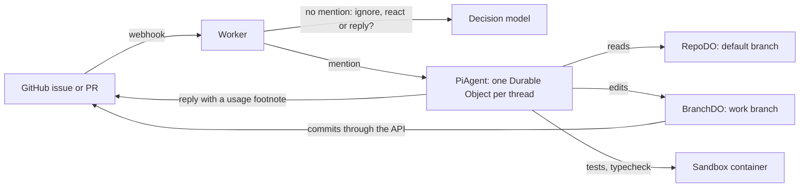

# Benny

A background coding agent that lives in GitHub issues and runs on Cloudflare Workers. I mention it on an issue, it researches, writes requirements, opens a PR, tests its own work and fixes review comments. My laptop can stay closed.

> **A personal project, shared as a reference.** Benny is not a product and has no support. It runs my own work on my own Cloudflare account. Read it, copy what you like, fork it.

<!-- Screenshot: a real issue → PR thread. -->

## Why I built it

- **To learn harness engineering.** I wanted to know how to build my own agent harness on [pi-durable](https://github.com/earendil-works/pi), on the Cloudflare Workers stack, with Durable Objects holding the files and running the agent.
- **To use what I already pay for.** The first quick win was a review agent on my spare OpenCode Go usage. Cheap models, my own customisations, no lock-in to one vendor's agent.
- **To put my work in one place.** GitHub is already my task tracker, my notes and my code host. Benny opens and updates its own issues, reads the state of its PRs, and leaves a trail I can read later.

## What a normal day looks like

1. I mention `@bobby-sb` on an issue and ask it to research something. Several threads run at once.
2. It writes the requirements with me in the thread until I'm happy with them.
3. I ask it to start. It works on its own branch, runs the tests and the typecheck in a sandbox, and opens a PR.
4. I ask it to review the PR, and then to fix what the review found.
5. Research jobs work the same way: "research these three topics and add the results to this issue".

This is the same loop I'd run locally with Claude Code. The difference is that I never think about which worktree or branch it's on, the laptop can be off, and the setup would still work if three people shared it.

## How it works

- **One agent per thread.** Each GitHub issue or PR gets its own `PiAgent` Durable Object. It sleeps between messages and costs nothing while it waits.
- **Files live in Durable Objects.** `RepoDO` holds the default branch and `BranchDO` holds the work branch. Commits go through the GitHub API, so there is no clone and no git process.
- **A sandbox only when it's needed.** Reading and editing code needs no container. Tests, typechecks and servers run in a Cloudflare Sandbox container with a cached package store.
- **A decision model for follow-ups.** After the first mention, every new comment in the thread is classified as ignore, react or reply, so Benny doesn't answer every "thanks".
- **Every reply says what it cost:** `Benny worked 4.2 min · 42 turns, 88k context (2.3M sent, 96% cached), 34k out · 12 tool calls · sandbox: 2 calls, 49 s`.

## Safety model

- **Who can start work:** only a mention from a repo member with write access can use a GitHub write or branch tool. The check reads GitHub permissions on every request.
- **What it can't do:** Benny opens PRs. It has no tool to merge, approve or close one, and it pushes only to `bobby/...` branches.
- **Sandbox network:** GET and HEAD to the npm registry only, with credentials stripped.
- **Secrets:** tools hide files like `.env` from the model.
- **Not covered:** text written by outsiders (comments, fetched web pages) can still steer a run that a member started. Don't install Benny on a repo where strangers comment.

## What I didn't build

- An install button, a hosted service or a multi-tenant setup.
- Merging. A person always merges.
- A UI. GitHub is the UI.
- Scheduled jobs. A person starts every run with a mention.

## Limitations

- Runs stop at a step limit. Very long tasks need a second mention.
- `pi-durable` is experimental, and the versions are pinned.
- Non-English "stop" commands aren't recognised. `@bobby-sb stop` always works.
- The GitHub App handle is still `bobby-sb` from before the rename, and so are the deployed Worker names.

Sandboxes on your own machine: about 21 MB per idle sandbox

Benny uses Cloudflare's containers. I also measured self-hosted sandboxes for my local agents, on a Hetzner box with 2 vCPU and 4 GB RAM, with gVisor, on 20 November 2026:

| Measurement | Result |
| --- | --- |
| RAM per idle Node sandbox | 21 MB (50 sandboxes: 1.1 GB) |
| Idle Claude Code session in a sandbox | 92 MB |
| Slowdown on `tsc` / on install | 1.3x / 1.8x |

The idle cost is small. The work inside (an install, a typecheck) is what uses memory: about 1 GB, in any sandbox.

When you're the only user and you know what the agent will do, running it on your own machine is fine. A sandbox helps when you want to let an agent try risky things freely without putting your own laptop at risk.

Running your own

You'll need a Cloudflare account with Containers, a GitHub App, and an OpenCode Go key. This is a sketch, not a supported install.

1. Create a GitHub App with issue, PR and contents permissions, and point its webhook at your Worker. Never give it the `workflows` permission.
2. Copy `.dev.vars.example` to `.dev.vars` and fill it in. Set the same values with `cf secret put <NAME>`.
3. Change the bot handle in `src/bot.ts` and the git identity in `src/repo-do.ts` to your App's.
4. `pnpm install`, then `pnpm codemode-sandbox:deploy` and `pnpm deploy`.

## Licence

[Apache 2.0](LICENSE). Built by [Devanshu Bhatt](https://github.com/madscientist111).
