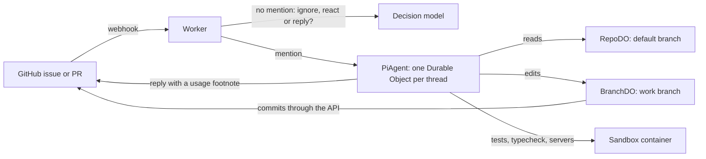

# Benny

A coding agent that lives in my GitHub issues. I mention it, it researches, writes the requirements with me, works on its own branch and opens a PR. It runs on Cloudflare Workers, so my laptop can be off.

> [!CAUTION]
> **This is an experiment.** Benny runs my own work on my own Cloudflare account. I share it as a reference for building an agent harness on Workers and Durable Objects. Read it, copy what you like, fork it.

<!-- Screenshot or GIF: a real issue thread, from the first mention to the opened PR. -->

## What a request looks like

The example is illustrative; the shape is real.

> **me:** @bobby-sb The dependency cache misses on every cold start, even when the lockfile is unchanged. Find out why and write the fix up as requirements on this issue.

Benny replies in the thread: what it read, what it found, what it proposes, and a question when it has one. We go back and forth until the requirements are right. Then:

> **me:** @bobby-sb start

It creates `bobby/issue-53`, commits there through the GitHub API and opens a PR that links the issue. Then:

> **me:** @bobby-sb Run the tests in the sandbox, then review the PR and fix what the review finds.

Every reply ends with a usage footnote, so I always know what a request took:

`Benny worked 4.2 min · 42 turns, 88k context (2.3M sent, 96% cached), 34k out · 12 tool calls · sandbox: 2 calls, 49 s`

## Why I built it

I wanted to learn harness engineering: build my own agent harness instead of living inside someone else's. [pi-durable](https://github.com/earendil-works/pi) gives me the agent loop. Cloudflare Workers run it, and Durable Objects hold the files and the running agents. I picked Cloudflare because it is extremely cheap, and because I think it's cool.

The first win came fast: a review agent on the spare OpenCode Go usage I was already paying for. Cheap models on a subscription, my own customisations, no lock-in to one vendor's agent.

The second win was putting everything in one place. GitHub is my Linear, my Notion and my code host. Benny creates and updates its own issues and tracks its progress there, in a UI I already live in.

## A normal day

I mention `@bobby-sb` on a few issues and ask it to research things. The threads run at the same time. On the one I care about, we write the requirements together until I'm happy. I say start. It works on its own branch and opens a PR. I ask it to test its own work, get the PR reviewed, and fix what the review found.

It is the same loop I run with Claude Code on my laptop, with three differences: the laptop can be off, it runs on my own infrastructure, and I never think about which worktree or branch it is on. Nothing in it would break if three people used it.

## How it is built

- **One agent per thread.** Each issue or PR gets its own `PiAgent` Durable Object. It sleeps between messages and costs nothing while it waits. A person starts every run with a mention; there is no schedule.
- **Files live in Durable Objects.** `RepoDO` holds the default branch, `BranchDO` the work branch. Commits go through the GitHub API: no clone, no git process.
- **A sandbox only when needed.** Reading and editing code needs no container. For tests, typechecks and servers I added Cloudflare Sandbox containers, with the pnpm store cached in R2 by lockfile hash.
- **A decision model for follow-ups.** After the first mention, every comment in the thread without a mention is classified as ignore, react or reply by a small model on Workers AI (`clef-flash`), so Benny doesn't answer every "thanks".
- **Models and search.** OpenCode Go, default `deepseek-v4.1-flash`. Web search through Exa. A public repo linked in the thread can be read, in its own Durable Object.

## What it may and may not do

- **Writes need a member.** A GitHub write or branch tool runs only when every pending request of the run is a mention from a repo member with write access. The check reads GitHub permissions on every request.
- **It opens PRs, and that's it.** There is no tool to merge, approve or close a PR. It pushes only to `bobby/...` branches and never changes `.github/workflows`.
- **Sandbox network:** GET and HEAD to the npm registry only, with credentials stripped.
- **Secrets:** the tools hide `.env`, `.dev.vars`, keys and the like from the model.
- **Not covered:** text from outsiders (comments, fetched web pages) can still steer a run that a member started. I run it only on repos where I know who comments.

## Limitations

- A run stops after 30 minutes and says so. A member replies in the thread to continue it; `@bobby-sb stop` stops it earlier.
- `pi-durable` is experimental, and the versions are pinned.
- The GitHub App is still called `bobby-sb` from before the rename, and so are the work branches and the deployed Workers.

Sandboxes on your own machine: about 21 MB per idle sandbox

Benny uses Cloudflare's containers. I also measured self-hosted sandboxes for my local agents, on a Hetzner box with 2 vCPU and 4 GB RAM, with gVisor, on 20 November 2026:

| Measurement | Result |
| --- | --- |
| RAM per idle Node sandbox | 21 MB (50 sandboxes: 1.1 GB) |
| Idle Claude Code session in a sandbox | 92 MB |
| Slowdown on `tsc` / on install | 1.3x / 1.8x |

The idle cost is small. The work inside (an install, a typecheck) is what uses memory: about 1 GB, in any sandbox.

When you're the only user and you know what the agent will do, running it on your own machine is fine. A sandbox lets an agent try risky things freely without putting your laptop at risk.

Running your own

You need a Cloudflare account with Workers, Durable Objects, Containers, R2 and Workers AI, a GitHub App, an OpenCode Go key and an Exa key. These are the steps I follow; your account will differ in places.

1. Create a GitHub App with issues, pull requests and contents permissions, and point its webhook at your Worker. Don't give it the `workflows` permission.
2. Copy `.dev.vars.example` to `.dev.vars` and fill it in. Set the same values in production with `cf secret put <NAME>`.
3. Change `BOT_USERNAME` and the bot's id in `src/bot.ts`, and `BENNY_GIT_IDENTITY` in `src/repo-do.ts`, to your App's.
4. `pnpm install`, then `pnpm codemode-sandbox:deploy`, then `pnpm deploy`.

## Licence

[Apache 2.0](LICENSE). Built by [Devanshu Bhatt](https://github.com/madscientist111).
